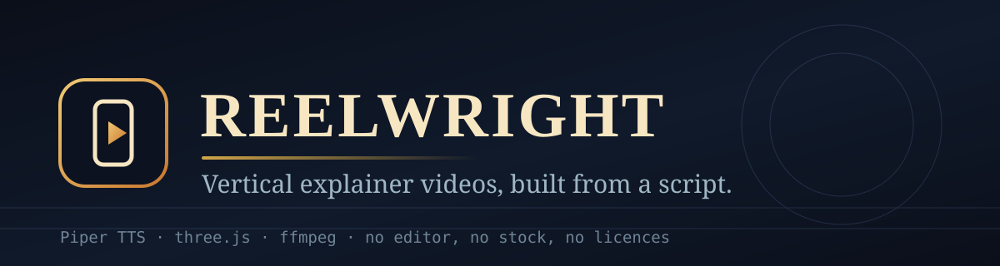
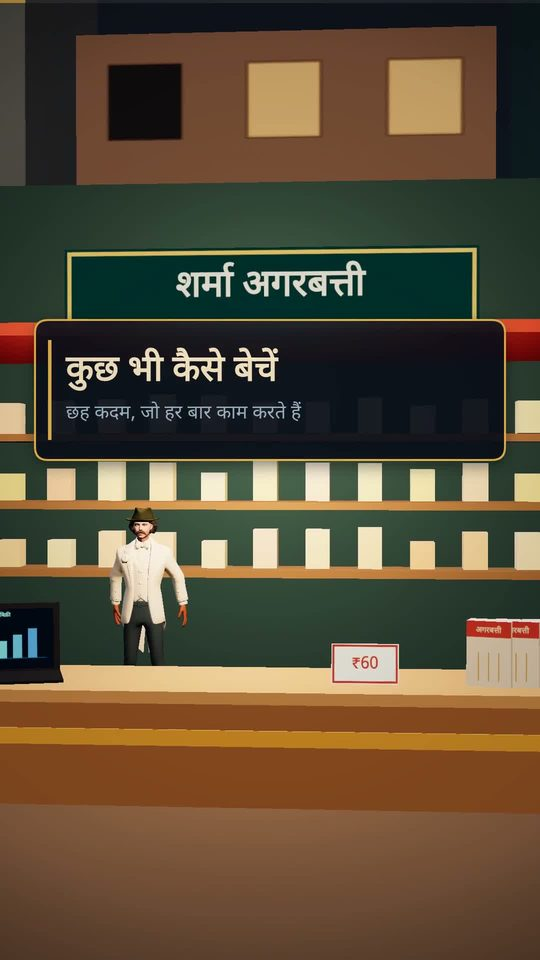
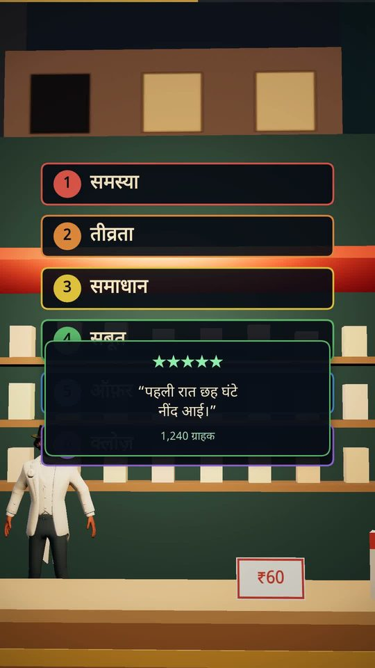
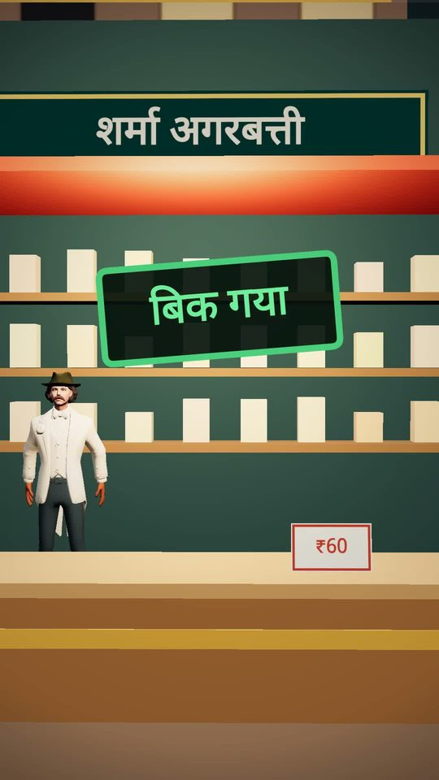

<div align="center">



<br>

**Write a script. Get a finished vertical video.** Voice, score, characters, motion graphics and frames — all generated from one JSON file. No editor, no stock footage, no licences to clear.

[](LICENSE)
[](requirements.txt)
[](package.json)
[](kit/lib/three.module.js)
[](#performance)
[](CONTRIBUTING.md)

`#vertical-video` `#explainer` `#three.js` `#text-to-speech` `#procedural-audio` `#ffmpeg` `#reels` `#shorts` `#pipeline`

</div>

---

Reelwright turns a written script into a narrated 9:16 film: a TTS voice measured to the millisecond, a score synthesised from sine waves, a rigged 3D character who moves his lips to the narration, motion graphics that stay crisp at any camera angle, and an MP4 at the end. It ran the 85-second Hindi explainer in [`films/kuch-bhi-kaise-bechein`](films/kuch-bhi-kaise-bechein) on a **2-core, 2 GB, GPU-less box**.

<div align="center">



</div>

## Contents

- [Why it exists](#why-it-exists)
- [Quickstart](#quickstart)
- [How it works](#how-it-works)
- [The script format](#the-script-format)
- [Styles](#styles)
- [Safe areas](#safe-areas)
- [Performance](#performance)
- [Quality control](#quality-control)
- [Project layout](#project-layout)
- [Craft rules](#craft-rules)
- [Roadmap](#roadmap)
- [Credits](#credits)
- [Licence](#licence)

## Why it exists

Making a decent explainer normally means an editor, a voice artist, a stock subscription and a licence audit. Reelwright replaces all four with a pipeline you can read:

| Normally | Here |
|---|---|
| Record voice, hand-time every cut | `voice.py` measures each line; the timeline is **generated** from it |
| Licence stock music | Score synthesised from sine waves, described as JSON cues |
| Rig a character in Blender | A rigged avatar posed bone-by-bone in code, lip-synced from the narration |
| Animate titles in After Effects | Motion graphics drawn in Canvas 2D at 1080×1920, in the same pass |
| Export and hope | `qa.py` checks every frame for black, blown, frozen and pop frames, plus loudness |
| Pick a look in a render engine | `"style": "toon"` gives cel shading + ink outlines; `"real"` gives lit surfaces |

## Quickstart

```bash
git clone https://github.com/apsideslabs/reelwright && cd reelwright
pip install -r requirements.txt && npm install          # puppeteer-core
# Chromium must be on PATH, or set CHROME=/path/to/chromium

./new-film.sh my-film                                   # scaffold from the worked example
$EDITOR films/my-film/film.json                         # your script, graphics, music
python kit/build.py --film films/my-film/film.json      # -> build/my-film/my-film.mp4
```

Prove the whole chain works, in about two minutes:

```bash
make test     # builds a 3-line film end to end at low res — 14 checks
```

Preview in seconds instead of an hour:

```bash
make preview FILM=films/my-film/film.json
# renders three stills at quarter size into build/my-film/preview/
```

## How it works

```
film.json ──► voice.py ──► narration.wav + timings.json + envelope.json
          └─► music.py ──► music.wav (score stem) + cues.json
                                    │
                                    ▼
                             mix.py ──► mix.wav  (ducked, -14 LUFS, stems, report)
                                    │
build.py ──► build/<slug>/site/     │
              timeline.js  ◄────────┘  every cut derived from measured speech
              film.js
              scene.js
                │
render.js ──► frames/f00000.jpg …   (resumable, chunkable)
                │
encode.py ──► <slug>.mp4 ──► qa.py ──► qa/qa-report.md + contact sheet
```

**The one idea worth stealing:** no scene ever contains a timestamp. It contains `T.s4`, and `T` is generated from the audio. Change a word and the whole film re-times itself.

```js
// films/*/scene.js
if (t < T.s3) return camLerp(K.wide, K.medium, easeInOut(seg(t, T.s2, T.s2 + 1.6)));
```

## The script format

Everything a film needs lives in one file — narration, scene beats, on-screen text, music cues. Full reference in [`docs/film-format.md`](docs/film-format.md).

```jsonc
{
  "slug": "my-film",
  "fps": 24,
  "voice": { "model": "hi_IN-pratham-medium", "length_scale": 1.09, "pitch": 0.955 },
  "lines": [
    { "id": "l1", "text": "This is where your story starts." },
    { "id": "l2", "text": "Then say the thing that changes how they see it." }
  ],
  "beats": { "s2": "l2", "s3": "l3" },
  "graphics": {
    "title": { "heading": "MY FILM", "sub": "a one-line promise" },
    "steps": [ { "n": "1", "label": "PROBLEM", "color": "#e0574a" } ]
  },
  "music": {
    "bed_gain": 0.42,
    "cues": [ { "at": "l1", "inst": "pad", "note": "C3", "dur": 9 } ]
  }
}
```

## Styles

One flag changes the whole look:

```jsonc
{ "style": "toon" }   // cel shading, four-step ramp, inverted-hull ink outlines
{ "style": "real" }   // lit surfaces, soft shading (default)
```

Toon mode swaps every material for `MeshToonMaterial` and renders through three.js's `OutlineEffect` — the flat-colour-plus-ink look most animated shorts are built from. Screen-space `fx` cues (`impact`, `sparkle`) punch beats on top. Details and tuning in [`docs/styles.md`](docs/styles.md).

## Safe areas

Vertical platforms paint their interface over your video. Reelwright lays every graphic inside the box TikTok, Reels and Shorts all leave clear — **x 120–880, y 290–1240** on a 1080×1920 frame — because before 1.4 the last two steps of a six-step checklist sat under TikTok's caption block.

```jsonc
{ "safeArea": "all" }   // all | tiktok | reels | shorts | none
```

Check any frame with `?safe=1` on the render URL; details and the pixel table in [`docs/safe-areas.md`](docs/safe-areas.md).

## Performance

No GPU required — Chromium falls back to SwiftShader, which is correct but slow.

| Resolution | Per frame | 60 s at 24 fps |
|---|---|---|
| 1080×1920 | ~2–4 s | 60–90 min |
| 720×1280 | ~1–1.5 s | 25–35 min |

Rendering is **resumable**: `render.js --resume` skips frames already on disk, and `build.py` loops in chunks until the film is complete. Kill it, run it again, it continues. On a 2 GB box, `encode.py` pins x264 to one thread; without that it dies with *Cannot allocate memory*.

## Quality control

`qa.py` is the part that keeps you honest. It decodes the finished MP4 at low resolution and reports:

```
PASS  0 problem(s), 2 warning(s)
  ! 3 still runs — a held camera is a choice, but a dead-still shot reads as a stall
luma mean 0.412 · motion mean 0.284 · black 0 · white 0 · pops 0
integrated loudness -14.2 LUFS · true peak -1.6 dBTP
```

It exits non-zero on failure, so it drops straight into CI. See [`docs/qa.md`](docs/qa.md).

## Project layout

```
kit/            the pipeline: voice, music, mix, render, encode, qa, build
kit/lib/        three.js, loaders, SkeletonUtils, Devanagari font, rigged avatar
films/          one directory per film: film.json + scene.js
templates/      starter film.json and index.html
docs/           format reference, customising, architecture, qa, troubleshooting
assets/         logo and banner
```

## Craft rules

Distilled from a careful study of the form (see [CREDITS](CREDITS.md)) and from rendering this kit's own films:

1. **A reaction lands 0–3 frames before its word.** Late feels like a delay, early feels like a prediction.
2. **The camera never fully stops.** A constant ~0.14 %/frame push is the difference between a hold and a stall.
3. **Blink in four frames** — half, shut, shut, half — every 0.5–2.3 s, and on every expression change.
4. **No crushed blacks.** Lift the floor slightly; pure black reads as a dead pixel, not a shadow.
5. **Time comes from the audio.** Never hand-place a cut you can measure.
6. **Never pure black.** Lift the floor to a warm (35,19,20) — see [docs/craft.md](docs/craft.md) for the numbers.

## Roadmap

- [ ] Word-level timing from Piper alignments (currently line-level)
- [ ] A second rigged avatar so casts stop sharing a face
- [ ] Optional depth-of-field pass (currently faked with fog)
- [ ] WebM/ProRes output alongside H.264

## Credits

Built by [@apsideslabs](https://github.com/apsideslabs). Adopts techniques from **[mromidev/claude-animated-shorts](https://github.com/mromidev/claude-animated-shorts)** (MIT) — see [`CREDITS.md`](CREDITS.md) for exactly what was taken and why.

Bundled third-party assets: [three.js](https://threejs.org) (MIT), a Ready Player Me sample avatar, [Noto Sans Devanagari](https://fonts.google.com/noto) (OFL), [Piper](https://github.com/rhasspy/piper) voices. Full table in [`NOTICE.md`](NOTICE.md).

## Licence

Code MIT — see [LICENSE](LICENSE). Check the licence of the specific Piper voice you ship.
